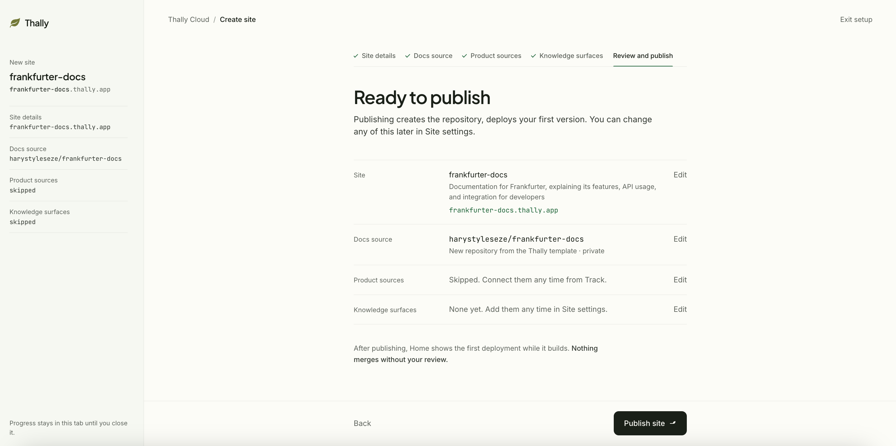
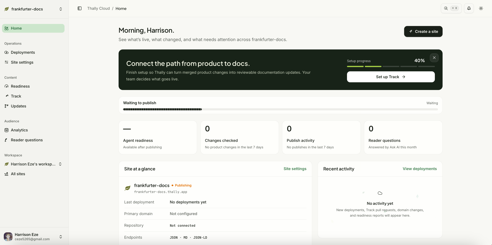
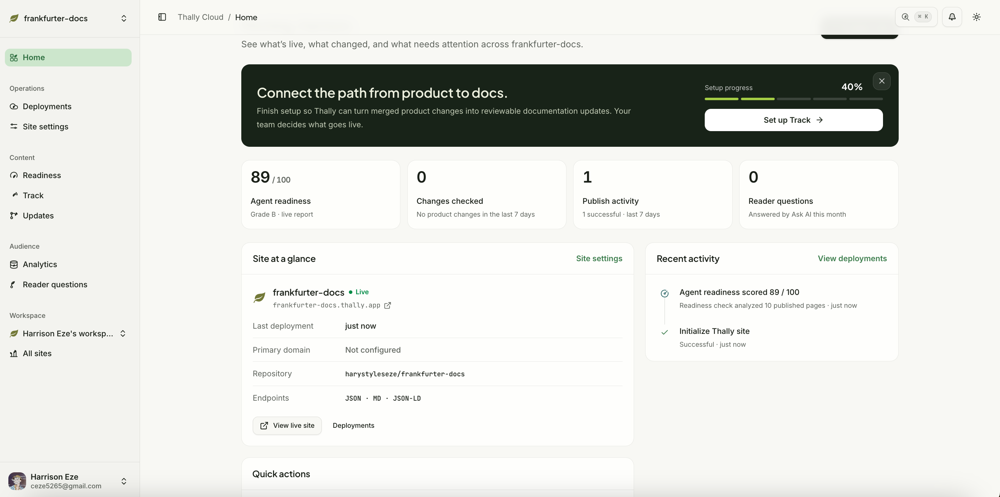

This article builds a documentation site for an HTTP API on [Thally](https://thally.io): an
introduction, a quickstart, one guide with troubleshooting, and an API reference generated from an
OpenAPI file with a console that sends real requests. The example API is
[Frankfurter](https://frankfurter.dev), a free exchange-rate API with no key.

- Live site: https://frankfurter-docs.thally.app
- Source: https://github.com/harystyleseze/frankfurter-docs

Thally takes a Git repository of MDX pages plus one `docs.json` file and publishes it as a Next.js
site. The same source also produces a Markdown mirror of every page, JSON and JSON-LD versions,
`llms.txt`, a search index, and a read-only MCP server. You can self-host the runtime or connect
the repository to Thally Cloud, which builds, previews, and publishes it. This article uses Cloud.

## Prerequisites

- A GitHub account. Thally creates the docs repository through a GitHub App.
- Node.js 20.19+, 22.14+, or 24, only for local preview. Publishing needs no Node.
- An API whose first request works without sign-up or approval.
- About two hours.

## Step 1: Run the quickstart's first request

Run the first command of your quickstart before writing anything. If it does not return a
successful response as-is, change the example.

```bash
curl https://api.frankfurter.dev/v2/rate/USD/NGN
```

```json
{"date":"2026-10-24","base":"USD","quote":"NGN","rate":1340.09}
```

Frankfurter needs no key, has no quota, covers 165 currencies, and publishes an OpenAPI spec at
`https://api.frankfurter.dev/v2/openapi.json`. The response above, with its real date and rate, is
what the quickstart page shows.

## Step 2: Create the site in Thally Cloud

Sign in at `app.thally.io` and select **Create a site**. The wizard has five steps.

**Site details.** Site name, one-line summary, and your `*.thally.app` address, checked for
availability as you type.


**Docs source.** The repository that is your site. It is the only thing Thally builds and
publishes. Three options:

- **Create a new docs repository** (recommended): a GitHub repo from Thally's starter template
  under your account. The **Private repository** toggle is on by default.
- **Import from a docs URL**: crawls a public documentation site into a new repository.
- **Use an existing repository**: a Thally project already on GitHub.


The first option installs the Thally Labs GitHub App, which asks for **All repositories** with read
and write access to code, pull requests, and workflows. If your organisation only allows
selected-repository installs, create a compatible repo first and use the third option.


**Product sources.** Optional. Other repositories, such as your API's code, that Thally Track
watches to propose documentation updates when they change. Skip for a first site.

**Knowledge surfaces.** Optional. Other repositories Track can write to but Thally does not build.
Skip for a first site.

**Review and publish.** Select **Publish site**.



Home shows **Waiting to publish**. While the first deployment runs, the Site at a glance panel
reads **Repository: Not connected**. This is not an error. Wait one to two minutes.



When the status is **Live**, the repository is linked, **View live site** opens the template
content, and the first agent-readiness report shows 89 out of 100, grade B, for ten starter pages.



## Step 3: Clone the repository

```bash
git clone https://github.com/<you>/<your-docs-repo>
cd <your-docs-repo>
npm ci
npm run dev   # http://localhost:3040
```

The repository is a copy of Thally's starter. You own these paths:

| Path | What it is |
|---|---|
| `src/content/**.mdx` | Pages. The file path is the URL: `guides/historical-rates.mdx` is `/guides/historical-rates`. |
| `docs.json` | Tabs, sidebar groups, page order, redirects, footer, feature flags. |
| `openapi.yaml` | Your API spec. One tab in `docs.json` points at it and the reference is generated. |
| `src/data/site.ts` | Site name, description, links, brand palette. |
| `AGENTS.md` | Writing rules for people and coding agents who edit the docs. |

Everything else is the runtime, pinned by `starter-release.json` and refreshed by a weekly "Update
Thally framework" pull request. Do not edit it.

## Step 4: Replace the OpenAPI spec

Download your spec and save it as `openapi.yaml`. For Frankfurter, `scripts/vendor-openapi.mjs`
in the repo converts the official JSON to YAML and makes three changes:

- adds a `tags` entry to every operation, because the sidebar groups endpoints by their first tag
  and the upstream spec has none;
- adds a `200` response example, captured with `curl`, to the two operations out of nine that lack
  one. Thally's readiness check `openapi_examples` fails any operation without a 2xx example;
- records the upstream version and capture date in `info.description`.

Point a tab at the spec in `docs.json`:

```json
{
  "tab": "API reference",
  "groups": [{ "group": "Overview", "pages": ["api/introduction"] }],
  "api": { "source": "openapi.yaml", "tagsOrder": ["Rates", "Currencies", "Providers", "Coverage"] }
}
```

Each operation becomes a page with parameters, examples, and a **Try it** panel. The panel relays
requests through the docs server, so the API does not need CORS. The request URL must match an
entry in the spec's `servers` list.

## Step 5: Write the pages

Delete the starter pages and write your own. Every page starts with frontmatter:

```yaml
---
title: Quickstart
description: Fetch the latest US dollar to Nigerian naira rate and convert an amount in JavaScript or Python, with no API key.
lastVerified: 2026-10-24
verifiedVersion: "2.1.1"
---
```

`title` and `description` are required. The description is the search snippet and the summary AI
tools see. `lastVerified` is the date a person ran the page's examples; the readiness report
rewards it, and `thally check --drift` can later flag pages whose sources changed since.

Components used on this site: `<Steps>` for the quickstart, `<Tabs>` for JavaScript and Python,
one `<Accordion>` per troubleshooting case, and `<Note>`, `<Tip>`, `<Warning>`.

Run every example and paste the real output. On this site that caught one failure: the Python
sample using `urllib` returned `403 Forbidden` with body `error code: 1010`, while `curl`, Node's
`fetch`, and `requests` succeeded. Frankfurter's CDN blocks Python's default User-Agent. Sending a
`User-Agent` header fixes it, and the fix is in the quickstart, the guide's troubleshooting, and
the API overview's error table.

Register every page in `docs.json`. An unregistered page is an orphan warning in `thally check`
and does not count in the readiness discovery check. Add `redirects` in `docs.json` for the
starter pages you deleted.

## Step 6: Validate locally

```bash
npm run check        # frontmatter, orphans, broken links and anchors, OpenAPI structure
npm run typecheck
npm run build
npm start            # then: curl -s localhost:3040/api/agent-readiness | jq '.score, .grade'
```

`npm run check` fetches the latest CLI through `npx` and needs network. `npm run build`
precompiles every MDX page; the same step runs on `postinstall`, so a broken page also fails
`npm ci`.

On the production build, readiness went from **89 (B)** to **100 (A)** after three changes: a
response example on every operation, `lastVerified` on every page, and a
`readiness.goldenQuestions` list in `docs.json` with eight questions and the page that should
answer each. That check runs the questions against the site's own search index.

## Step 7: Publish through a pull request

```bash
git checkout -b docs/frankfurter-v2-launch
git add -A
git commit -m "docs: document the Frankfurter v2 API"
git push -u origin docs/frankfurter-v2-launch
```

Open the pull request. The repository's CI reads the changed paths: a diff limited to
`src/content/`, `docs.json`, or `openapi.yaml` runs only `thally check --ci`; anything else runs
the full typecheck and production build. Per Thally's documentation, Cloud also builds an isolated
preview for each docs pull request, listed on the **Deployments** page, and merging to `main`
publishes after validation, with rollback from the same page.

After the merge, confirm the outputs:

```bash
curl -s https://frankfurter-docs.thally.app/llms.txt | head
curl -s https://frankfurter-docs.thally.app/quickstart.md | head
curl -s https://frankfurter-docs.thally.app/api/agent-readiness | jq '.score, .grade'
npx @modelcontextprotocol/inspector --cli https://frankfurter-docs.thally.app/api/mcp --transport http --method tools/list
```

> **Verified after merge:** this block is updated with the live readiness score, the `llms.txt`
> page list, and the MCP tool count once the pull request is merged. Until then, numbers in this
> article are from the local production build.

## Findings for the Thally team, with steps to reproduce

### 1. Every new site starts with a failing check it did not cause

**Steps:** create a site from the starter template; open the readiness report.
**Observed:** 89/100, grade B. `openapi_examples` fails because the starter's sample
`openapi.yaml` has operations without 2xx examples.
**Expected:** a clean baseline.
**Suggestion:** ship the starter spec with examples on every operation.

### 2. `thally check` passes a page that cannot compile, and content-only CI runs only `thally check`

**Steps:** create `src/content/_broken.mdx` with valid frontmatter and an unclosed `<Note>`; run
`npm run check`; then run `npm run runtime-sources:build`.
**Observed:** `check` reports `"_broken" is not in docs.json nav (orphan)` and `Very short body`
and exits cleanly. The build fails with
`Failed to compile runtime MDX src/content/_broken.mdx: Expected a closing tag for <Note> (2:1-2:7)`.
CI selects the content-only path for a diff under `src/content/`, which runs only
`thally check --ci`.
**Expected:** a pull request that will fail to build is not green.
**Suggestion:** compile MDX in `check`, or add `runtime-sources:build` to the content-only CI path.
The compile error itself is good: it names the file and line.

### 3. Unknown frontmatter keys are accepted silently

**Steps:** add `sidebarTitle: Wrong label` to any page; run `npm run check`.
**Observed:** "No issues found." The sidebar label does not change. The documented field is
`navTitle`; `sidebarTitle` is the name another docs tool uses, so migrating teams will type it.
**Expected:** a warning for keys the runtime does not read.
**Suggestion:** validate frontmatter against the documented key list and warn on the rest.

### 4. The wizard and first Home page use terms they do not define

**Steps:** run the Create a site wizard without reading the Cloud guides.
**Observed:** "Docs source", "Product sources", and "Knowledge surfaces" are step titles with no
definition in place. During the first publish, Home shows **Repository: Not connected** and a
**Set up Track** banner at 40% before the first deployment has finished.
**Expected:** one sentence per step saying what it is and whether it is needed today; a status that
reads as in progress rather than disconnected.
**Suggestion:** inline definitions with a "Learn more" link; hold the Track prompt until the first
deployment is live.

### 5. Search prefers generated operation pages for questions containing "rate"

**Steps:** add the golden question "How often are rates updated and should I cache them?" with the
API overview as the expected page; run the readiness report.
**Observed:** the question missed the top five; the generated `/rates` pages outranked the prose
page that answers it. Rewording to "Should I cache responses, and how often does Frankfurter
publish new rates?" fixed it.
**Expected:** an authored page whose description answers the question outranks a reference page
that shares a token.
**Suggestion:** boost authored pages, or weight operation-path matches less.

## What worked

Publishing needed no local tooling. The readiness report gives a fix hint per failing check. The
Try it console relays requests server-side, so CORS never came up. One source produced the HTML,
the Markdown mirrors, `llms.txt`, and the MCP server with no second pipeline.
