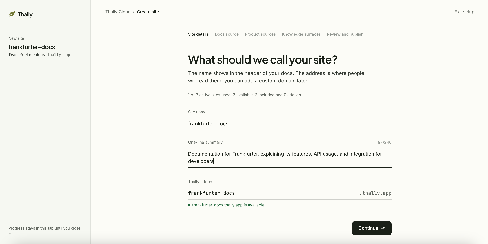
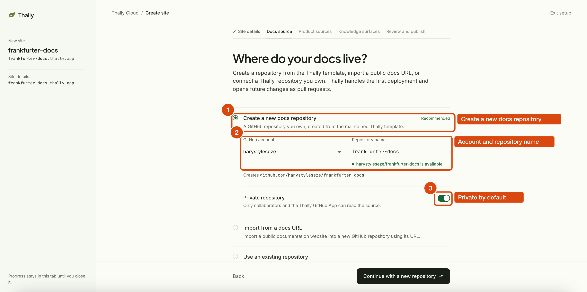
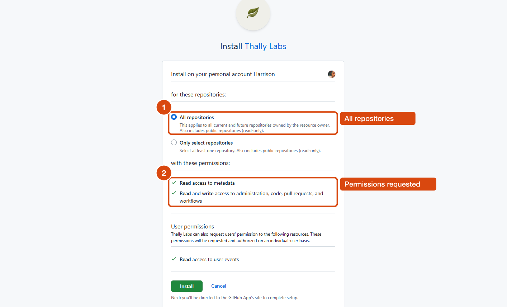
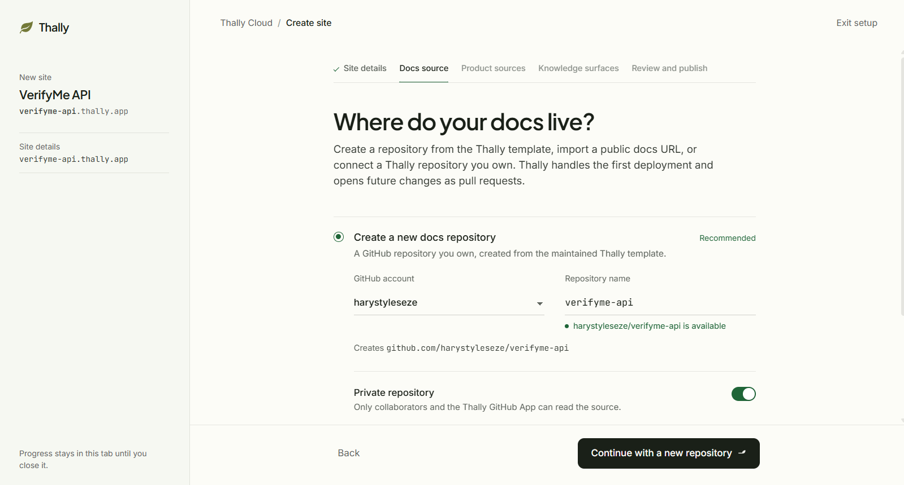
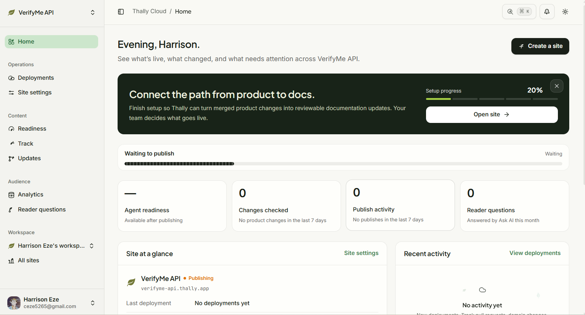
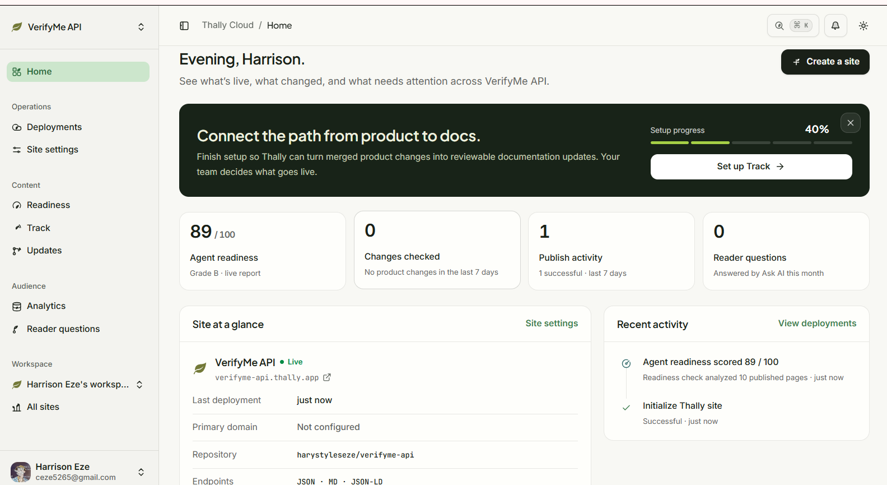

I needed to publish a small, honest documentation site for an HTTP API, and I wanted every
command in it to actually work. This article walks through how I did that with
[Thally](https://thally.io), an open-source documentation engine with a managed hosting layer,
using the free [Frankfurter](https://frankfurter.dev) exchange-rate API as the subject.

The result is live at **https://frankfurter-docs.thally.app** and the source is at
**https://github.com/harystyleseze/frankfurter-docs**. If you follow along you will end with the
same kind of site for your own API: an introduction, a quickstart, one practical guide, and an
API reference generated from an OpenAPI file, with a console that sends real requests.

## What Thally is, in one paragraph

Thally takes a Git repository of MDX pages plus one `docs.json` file and publishes it as a
Next.js site. The same source also produces Markdown mirrors of every page, JSON and JSON-LD
versions, `llms.txt`, a search index, and a read-only MCP server, so humans and AI tools read the
same content. You can self-host the runtime, or connect the repo to Thally Cloud and let it
build, preview, and publish for you. I used Cloud.

## Prerequisites

- A GitHub account. Thally creates the docs repository for you through a GitHub App.
- Node.js 20.19+, 22.14+, or 24 if you want to preview locally. Publishing itself needs no Node.
- An API to document. Pick one you can call without approval steps. More on that below.
- About two hours.

## Step 1: Choose an API you can actually call

My first choice was a Nigerian identity-verification API I had used before. It turned out to need a
corporate account, an account manager to enable API access, and a funded balance before a single
request would work. None of that fits a quickstart, so I switched to Frankfurter: no API key, no
quotas, 165 currencies including the naira, and an official OpenAPI specification at
`https://api.frankfurter.dev/v2/openapi.json`.

The lesson: before you write a word, run the first request of your quickstart. If a stranger
cannot reproduce it in five minutes, change the example or change the product.

## Step 2: Create the site in Thally Cloud

Sign in at `app.thally.io` and select **Create a site**. The wizard has five steps.

1. **Site details.** Name, one-line summary, and your `*.thally.app` address. The address is checked
   for availability as you type.

   

2. **Docs source.** Choose **Create a new docs repository**. Thally creates a GitHub repo from its
   starter template and makes the first deployment.

   

   This is where the GitHub App gets installed. The recommended path asks for **All repositories**
   access with read and write on code, pull requests, and workflows. If your organization only
   allows selected-repository access, you have to create a compatible repo first and use the
   **Use an existing repository** option instead.

   

   Back in the wizard, pick the account and repository name. I kept the repository private at first
   and made it public later.

   

3. **Product sources.** Optional. These are *other* repositories, such as your API's code, that
   Thally Track watches so it can propose documentation updates when they change. I chose
   **I'll do this later**.
4. **Knowledge surfaces.** Optional, and only shown for some workspaces. Skip it for a first site.
5. **Review and publish.** Select **Publish site**. The dashboard shows **Publishing** and, a minute
   or two later, **Live** with an agent-readiness score for the starter content.

   

   

At this point you have a working site serving template text. Everything from here is Git.

## Step 3: Clone and understand what you own

```bash
git clone https://github.com/<you>/<your-docs-repo>
cd <your-docs-repo>
npm ci
npm run dev   # http://localhost:3040
```

The repository is a copy of Thally's starter. Only a handful of paths are yours:

| Path | What it is |
|---|---|
| `src/content/**.mdx` | Pages. The file path is the URL: `guides/historical-rates.mdx` is `/guides/historical-rates`. |
| `docs.json` | Tabs, sidebar groups, page order, redirects, footer, and feature flags. |
| `openapi.yaml` | Your API spec. One tab in `docs.json` points at it and the reference is generated. |
| `src/data/site.ts` | Site name, description, links, brand palette. |
| `AGENTS.md` | Writing rules for people and coding agents who edit the docs. |

Everything else is the runtime, pinned by `starter-release.json` and refreshed by a weekly
"Update Thally framework" pull request. Leave it alone and updates stay painless.

## Step 4: Replace the OpenAPI spec

I downloaded Frankfurter's official spec and converted it to YAML with a short Node script
(`scripts/vendor-openapi.mjs` in the repo) that also:

- adds a `tags` entry to every operation, because the sidebar groups endpoints by their first tag
  and the upstream spec had none;
- adds a real `200` response example to the two operations that lacked one, captured with `curl`;
- records the upstream version and capture date in `info.description`.

Why bother with examples? Thally's agent-readiness report has a check called `openapi_examples`
that fails any operation without a 2xx example. The starter's own sample spec fails it, which is
why a brand-new site scores 89 instead of higher.

The `docs.json` side is three lines:

```json
{
  "tab": "API reference",
  "groups": [{ "group": "Overview", "pages": ["api/introduction"] }],
  "api": { "source": "openapi.yaml", "tagsOrder": ["Rates", "Currencies", "Providers", "Coverage"] }
}
```

Each operation becomes a page with parameters, examples, and a **Try it** panel. The panel sends
requests through the docs server, so the target API does not need CORS, but the request URL must
match a `servers` entry in the spec.

## Step 5: Write the pages

I wrote five pages and deleted the starter's placeholders. Every page starts with frontmatter:

```yaml
---
title: Quickstart
description: Fetch the latest US dollar to Nigerian naira rate and convert an amount in JavaScript or Python, with no API key.
lastVerified: 2026-10-24
verifiedVersion: "2.1.1"
---
```

`title` and `description` are required, and the description doubles as the search snippet and the
summary AI tools see. `lastVerified` is a promise that a human ran the page's examples on that
date; the readiness report rewards it, and `thally check --drift` can later flag pages whose
sources changed since.

A few MDX components carried the whole site: `<Steps>` for the quickstart, `<Tabs>` for
JavaScript versus Python, `<Accordion>` for each troubleshooting case, and `<Note>`,
`<Tip>`, and `<Warning>` callouts. Nesting a fenced code block inside a `<Step>` works as long as
you keep a blank line before the fence.

Two rules I followed that paid off:

1. **Run every example and paste the real output.** The quickstart's Python sample failed on the
   first run with `403 Forbidden`. Frankfurter sits behind Cloudflare, which blocks Python's
   default `User-Agent`. `curl`, Node.js `fetch`, and the `requests` library all worked. Setting
   a `User-Agent` header fixed it, and that finding became a troubleshooting entry instead of a
   reader's bad afternoon.
2. **Register every page in `docs.json`.** Orphan pages are warnings in `thally check`, and the
   readiness report's discovery check counts pages that are in navigation.

For the deleted starter pages I added `redirects` in `docs.json` so old links land on the
introduction rather than a 404.

## Step 6: Validate locally

```bash
npm run check        # frontmatter, orphans, broken links and anchors, OpenAPI structure
npm run typecheck
npm run build
npm start            # then: curl -s localhost:3040/api/agent-readiness | jq .score
```

`npm run check` runs the official CLI through `npx`, so it needs network and takes a few seconds
to fetch the latest version each time. It passed first time here, but it is the tool that would
catch a broken link to a generated API page, whose slugs follow the pattern
`/api/default/<path-without-braces>/<method>`, for example `/api/default/rate/base/quote/get`.

The build precompiles every MDX page. A syntax error in one page fails the whole build, and it
also fails `npm install` because the same step runs on `postinstall`. Treat MDX like code.

Agent readiness went from **89 (B)** on the starter to **100 (A)** after three changes:
response examples on every operation, `lastVerified` on every page, and a `readiness.goldenQuestions`
list in `docs.json` with eight questions a reader might ask and the page that should answer each.
That last one runs against the site's own search index, so it is a cheap, deterministic test that
your titles and descriptions use the words readers use.

## Step 7: Publish through a pull request

```bash
git checkout -b docs/frankfurter-v2-launch
git add -A
git commit -m "docs: document the Frankfurter v2 API"
git push -u origin docs/frankfurter-v2-launch
```

Opening the pull request did two things without any configuration: the repository's CI workflow
ran `thally check --ci`, and Thally Cloud built an isolated preview deployment for the branch.
The preview has its own address, listed on the Cloud **Deployments** page with status **Ready**. It stays separate from production, cannot promote itself, and retires when the pull request closes, so it is the right place to click through every page on a phone before merging.

Merging to `main` published the site. Content-only changes take a fast path; this one touched
`docs.json` and `site.ts` as well, so it went through a full build and still finished in a few
minutes. The **Deployments** page keeps the history and offers a one-click rollback.

Afterwards I verified the surfaces I care about:

```bash
curl -s https://frankfurter-docs.thally.app/llms.txt | head
curl -s https://frankfurter-docs.thally.app/quickstart.md | head
curl -s https://frankfurter-docs.thally.app/api/agent-readiness | jq '.score, .grade'
npx @modelcontextprotocol/inspector --cli https://frankfurter-docs.thally.app/api/mcp --transport http --method tools/list
```

## Obstacles and how I resolved them

| Obstacle | Resolution |
|---|---|
| The API I knew best needs a paid, approved account | Switched to a keyless API with an official OpenAPI spec |
| Python `urllib` returned `403` from the API's CDN | Set a `User-Agent` header; documented it in three places |
| Upstream spec had no `tags`, so endpoints would land in one flat group | Added tags in the vendoring script instead of hand-editing the spec |
| Starter spec fails the readiness `openapi_examples` check | Added a 2xx example to every operation |
| Deleting all starter guides removed the `guides/` folder, so my first write of the guide failed | `mkdir -p` before writing; trivial, but it would confuse a newcomer |
| The wizard's terms (Docs source, Product sources, Knowledge surfaces) were not explained in place | Read the Thally Cloud and Track guides first; summarized them in this article's step 2 |

## What I would tell a colleague

Thally's strongest idea is that one reviewed source feeds every output, and the readiness report
turns "is this good for AI agents?" into a checklist with concrete fix hints. The Cloud publish
path genuinely needs zero local tooling. The friction I hit was mostly about words: the product
has several overlapping names for related features, and the wizard assumes you already know them.
None of it blocked me, and the whole thing fit in an afternoon.

If you build one, start by running your quickstart's first command. Everything else follows.
